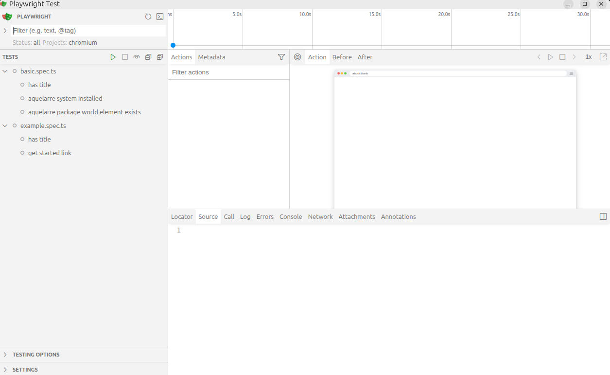
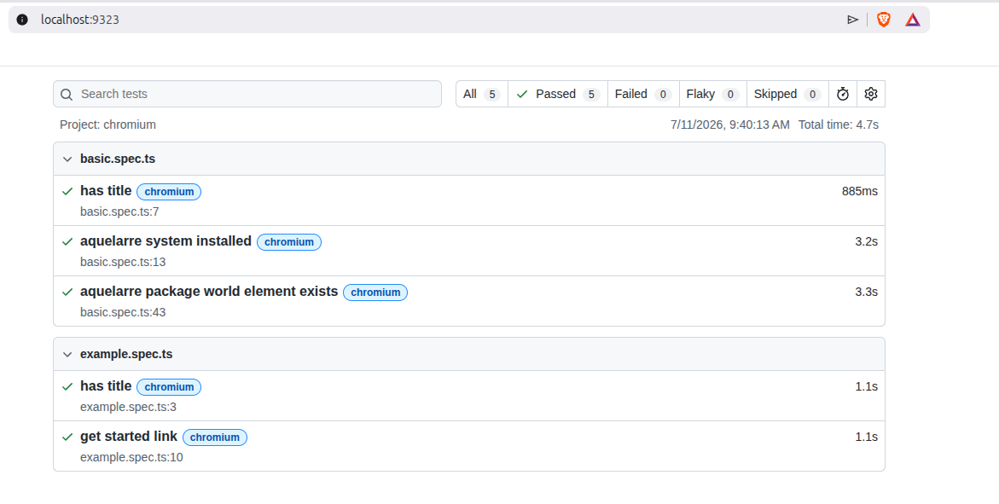
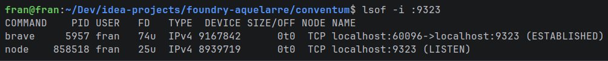

# Test Playbook

El framework usado para testear la UI es [PlayWright](https://playwright.dev/)

Los tests están localizados en la carpeta `tests`.

Los test se conectan a una url (local o remota) y se ejecutan contra la UI que ofrece FoundryVTT.

Necesitaremos dos módulos para ejecutar los UI tests: 
1. Instalar y correr un foundryVTT server (local o remoto)
2. Instalar `PlayWright` en nuestra máquina local para ejecutar los tests


### 1. FoundryVTT + Containers (local)

Una de las mejores opciones para correr FoundryVTT es usar una arquitectura de containers. Para ello, se puede usar `Docker` o `Podman`. Los principales proyectos de 
foundryVTT deployados en containers se puede consultar en la [web oficial](https://foundryvtt.wiki/en/setup/hosting/Docker).

Una de las opciones más sencillas de instalar es [Feddly](https://github.com/felddy/foundryvtt-docker)

#### Requisitos

- Instalar [docker](https://docs.docker.com/engine/install/)

#### Instalación

Para obtener todos los detalles consulta el [README](https://github.com/felddy/foundryvtt-docker/blob/develop/README.md) del proyecto. 

1. Crear un `compose.yml`:

``` yaml
---
services:
  foundry:
    image: ghcr.io/felddy/foundryvtt:14
    hostname: my_foundry_host
    volumes:
      - type: bind
        source: <your_data_dir>
        target: /data
    environment:
      - FOUNDRY_USERNAME=<your_username>
      - FOUNDRY_PASSWORD=<your_password>
      - FOUNDRY_ADMIN_KEY=atropos
      - FOUNDRY_TELEMETRY=true
    ports:
      - target: 30000
        published: 30000
        protocol: tcp
```

2. Iniciar el container con la configuración del `compose.yml`:

``` console
docker compose up -d
```

3. Pasados unos segundos, deberías poder acceder a la UI de FoundryVTT en: http://localhost:30000.

### 2. Instalar PlayWright

#### Desde 0

``` console
npm init playwright@latest
```
El script te ofrece una serie de elecciones. Una vez finalizado, los archivos de configuracion para correr los tests seran creados en el folder indicado.

Tipos de archivos creados:
- `playwright.config.ts`         # Test configuration
- `package.json`
- `package-lock.json`            # Or yarn.lock / pnpm-lock.yaml
- `tests/example.spec.ts`        # Minimal example test

Nota1: en función del entorno y la plataforma es necesario instalar las dependencias necesarias para ejecutar los tests. Por ejemplo, en Windows es necesario instalar el paquete `windows-build-tools` y en macOS es necesario instalar el paquete `xcode-select --install`. Además, es necesario tener instalado Node.js y npm.

Nota2: para reducir el tiempo de ejecución de los tests, firefox y webkit fueron deshabilitados. Se puede habilitar descomentando las líneas correspondientes en el archivo `playwright.config.ts`

Nota3: toda la información necesaria de instalación se encuentra en la [fuente oficial](https://playwright.dev/docs/running-tests)

#### Browsers + Dependencias

Una vez hecho el checkout del proyecto no deberia hacer falta recrear todos los archivos de configuración para correr los tests. 

Instalar browers:
(todos)
``` console
npx playwright install
```
(chromium)
``` console
npx playwright install chromium
```

Instalar dependencias:
(todos los browsers)
``` console
npx playwright install-deps
```
(chromium)
``` console
npx playwright install-deps chromium
```

## Como ejecutar los tests

### IntelliJ

3 opciones:
- Click derecho en el archivo test y click en `Run` o `Debug`
- Click en un test específico dentro del test en cuestión
- Mediante test configurations.

### Terminal

Sin UI:
``` console
npx playwright tests
```

Con UI:
``` console
npx playwright tests --ui
```



Consultar el test report:
``` console
npx playwright show-report
```



Nota: 
He observado que en ocasiones `Playwright` no cierra bien el puerto usado para lost reports (9323)



``` console
lsof -i :9323
```